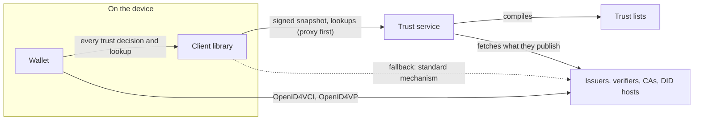

# Wallet Proxy

[](https://github.com/jainhitesh9998/wallet-proxy/actions/workflows/ci.yml)
[](https://github.com/jainhitesh9998/wallet-proxy/actions/workflows/conformance.yml)
[](LICENSE)

A trust layer for OpenID4VCI / OpenID4VP wallets and verifiers.

Documentation: <https://jainhitesh9998.github.io/wallet-proxy/> (guides, REST API, TypeScript and Java API
references).

A **trust service** compiles trust lists of any kind (X.509 trust anchors for ISO mdoc / mDL, ETSI trusted lists,
OpenID Federation, EBSI, a plain registry) into one registry, signs a snapshot of it for each client, and proxies the
lookups a wallet needs about the parties it deals with: issuer metadata, DID documents, certificate revocation lists,
credential status lists, JSON-LD contexts.

A **client library** (`@vctrust/trust-client`) is how an app consumes it. Trust decisions are made on the device,
from the signed snapshot. Lookups go through the proxy first and fall back to the standard mechanism of each
specification when the proxy cannot serve. Without the service, only trust pinned in the app decides.



An arrow points from the one who asks to the one who answers.

### Who uses what

- **The wallet gets its trust from the library and from nowhere else.** The wallet core takes a trust client and asks
  it whether an issuer or a verifier is trusted, and for what it needs to know about them: issuer metadata, DID
  documents, revocation lists, status lists, JSON-LD contexts. Trust pinned in the app is given to the library too.
  The demo app is a UI over the wallet core.
- **The wallet still speaks OpenID4VCI and OpenID4VP to the issuer and the verifier itself.** The trust service is not
  part of that exchange: it proxies trust material, not the protocols.
- **Issuers and verifiers use nothing from this repository.** They are who the wallet asks *about*: entries in the
  trust lists, whose published material the service fetches (or the library, as fallback). An issuer or verifier that
  follows the specifications works unchanged. The reference issuer and verifier in [`test-ecosystem/`](test-ecosystem)
  are built on third-party implementations for that reason, and depend on neither the library nor the wallet core.

```
apps/wallet  ──►  @vctrust/wallet-core  ──►  @vctrust/trust-client  ──►  trust service
                                                      └──►  standard mechanisms, pinned trust (fallback)
test-ecosystem (reference issuer, verifier)  ──►  third-party implementations only
```

### What the wallet gets through the library

| What the wallet needs | Where it comes from | When the service cannot serve |
| --- | --- | --- |
| Is this issuer or verifier trusted? (an X.509 chain to a listed anchor, a DID, an identifier) | Decided on the device, from the signed snapshot | Trust pinned in the app |
| Certificate revocation lists (CRLs) | In the snapshot for the trust anchors; through the proxy for CAs below them | Where the CA publishes: the certificate's distribution point, or the location in the anchor's record |
| Credential status lists (Token Status List, Bitstring Status List) | Through the proxy | The list's own URI |
| DID documents | In the snapshot for listed DIDs; through the proxy for others | The DID method (`did:web` over https; `did:key` and `did:jwk` are computed locally) |
| Issuer and authorization server metadata | Through the proxy | Discovery at the issuer |
| JSON-LD contexts | In the snapshot for the listed parties; through the proxy for others, held to the digest the snapshot carries | The context's URL. Either way, a context the snapshot has no digest for is reported as not vouched for |

Whatever is relayed is verified on the device: a CRL against the CA that issued it, a status list against its signer,
a JSON-LD context against the digest in the snapshot, everything else against the pinned key of the service. OCSP is
not used. How each of these is configured and
decided: [Trust methods](docs/trust-methods.md).

- [Architecture](docs/architecture.md): the registry, the snapshot, how a decision is made, the proxy, what happens
  when things fail, the security model, the evidence of conformance.
- [Configuration guide](docs/configuration.md): the service, the client library, the wallet core.
- [Trust methods](docs/trust-methods.md): X.509 chains, CRLs, status lists, DIDs, issuer metadata and JSON-LD
  contexts, one by one, and trust mechanisms of the operator's own: what the operator lists, what the device checks,
  and an example to run.
- [API description](docs/openapi.json) (also served at `/swagger-ui.html`).

## Repository

| Path | What |
| --- | --- |
| [`trust-server/`](trust-server) | The trust service: `trust-core` (registry, evaluator, X.509, DID), `trust-adapters` (trust list formats), `trust-server` (Spring Boot API). Java 21, Maven |
| [`packages/trust-client/`](packages/trust-client) | **The client library**, `@vctrust/trust-client`. TypeScript; Node, browsers, React Native. No platform crypto dependencies |
| [`packages/wallet-core/`](packages/wallet-core) | `@vctrust/wallet-core`: OpenID4VCI 1.0, OpenID4VP 1.0 and HAIP wallet logic with credential verification. Every trust decision and lookup goes through the library |
| [`apps/wallet/`](apps/wallet) | A demo wallet (Expo: Android, iOS, web): a UI over the wallet core |
| [`test-ecosystem/`](test-ecosystem) | A reference issuer and verifier to test against, built on third-party implementations. They do not use the library |
| [`conformance/`](conformance) | Shared test PKI, evaluation vectors both evaluators must agree on, credentials from real issuers |
| [`e2e/`](e2e), [`scripts/`](scripts) | UI tests; build, run and test helpers |

## Quick start

Needs JDK 21, Maven 3.9 and Node 22 (`. scripts/env.sh` loads a user-local toolchain from `~/.local/tools` when
there is one).

```sh
scripts/build.sh            # builds and tests the service; installs and builds the TypeScript packages
scripts/dev-up.sh           # trust service :8090, reference issuer :8791 and verifier :8792, listed in the service
```

Look at what a wallet gets:

```sh
curl -s localhost:8090/.well-known/trust-service                       # endpoints, the signing key thumbprint to pin
curl -s -H 'Authorization: Bearer demo-wallet-key' -H 'Accept: application/jwt' localhost:8090/api/v1/snapshot
curl -s -H 'Authorization: Bearer demo-wallet-key' 'localhost:8090/api/v1/issuers'
```

Run the demo wallet and give it a credential offer from the reference issuer:

```sh
npm run web -w @vctrust/wallet-app
curl -s localhost:8791/api/offers -H 'Content-Type: application/json' -d '{"configurationIds":["mDL_mso_mdoc"]}'
```

`scripts/dev-down.sh` stops everything.

## Using the library

```ts
import { createTrustClient } from '@vctrust/trust-client';

const trust = createTrustClient({
  service: { url: 'https://trust.example.org', clientId: 'wallet-app', apiKey: '...', keys: { thumbprints: ['...'] } },
});

// Decided on this device, from the signed snapshot:
const issuer = await trust.evaluateIssuer({ credentialIssuer: 'https://issuer.example.org', format: 'mso_mdoc', type: 'org.iso.18013.5.1.mDL' });
const signer = await trust.evaluate({ role: 'issuer', subject: { x5c }, context: { credentialFormat: 'mso_mdoc', credentialType: 'org.iso.18013.5.1.mDL' } });
const verifier = await trust.evaluateVerifier({ clientId, x5c, responseUri });

// Through the proxy, with the standard mechanism as fallback:
const metadata = await trust.getIssuerMetadata('https://issuer.example.org');
const did = await trust.resolveDid('did:web:issuer.example.org#key-1');
const status = await trust.checkTokenStatus({ idx, uri }, { signerX5c: x5c });
```

See [`packages/trust-client/README.md`](packages/trust-client/README.md).

### Where the library lives

The library is [`packages/trust-client`](packages/trust-client) of this repository: it is developed next to the
service because the two share their rules and are tested against each other
([`conformance/`](conformance)). It has no dependency on the rest of the repository at run time.

- Inside this repository it is an npm workspace: `@vctrust/trust-client`, and `@vctrust/trust-client/primitives` for
  its building blocks.
- For another project: every GitHub release (tag `v<version>`) carries the library as an npm tarball, which installs
  by URL: `npm install https://github.com/jainhitesh9998/wallet-proxy/releases/download/v0.1.0/vctrust-trust-client-0.1.0.tgz`.
  Locally, `npm pack -w @vctrust/trust-client` builds the same tarball.
- The `Publish packages` workflow publishes it to GitHub Packages when a release is published, as
  `@jainhitesh9998/trust-client` (GitHub's npm registry takes only packages scoped to the repository owner, so the
  workflow renames `@vctrust/*` for the upload). A project that installs it needs an `.npmrc` with
  `@jainhitesh9998:registry=https://npm.pkg.github.com` and a token that may read packages. The wallet core is
  published the same way and installs the library under the name `@vctrust/trust-client`. The Java modules are
  published there as Maven artifacts (`io.vctrust`).
- React Native (Metro) resolves the package through its `react-native` export condition, to the TypeScript sources.

## Tests

```sh
scripts/test-all.sh --offline     # everything that needs no network
scripts/test-all.sh               # plus the live suites (needs the internet and scripts/dev-up.sh)
```

| Suite | What it covers | Needs |
| --- | --- | --- |
| `trust-server` (JUnit) | Evaluator, X.509 and CRLs, DID drivers, list adapters, API, authentication, caches; generates and checks the evaluation vectors, and the second pair under trust mechanisms | nothing |
| `packages/trust-client` (Vitest) | The client: snapshot handling, proxy and fallback, strict parsers, the evaluation vectors and the second pair under trust mechanisms | nothing |
| `packages/trust-client`, x509-limbo | X.509 path validation against the C2SP limbo suite | `LIMBO_JSON=$(sh packages/trust-client/scripts/fetch-limbo.sh)` |
| `test-ecosystem` (Vitest) | The reference issuer and verifier against their own third-party clients | nothing |
| `packages/wallet-core` (Vitest) | Strict credential verification, OpenID4VCI / OpenID4VP flows, the wallet against the reference ecosystem, credentials real issuers issued | nothing |
| `packages/wallet-core`, live | The wallet through the running trust service: reference ecosystem end to end; Animo playground; walt.id demo issuer (mDL, EUDI PID) | internet, `scripts/dev-up.sh` |
| `packages/trust-client`, live | Service and device decide alike, over HTTP | `scripts/dev-up.sh` |
| `e2e` (Playwright) | The demo wallet's UI | `scripts/dev-up.sh` |

## Automation

| Workflow | When | Does |
| --- | --- | --- |
| [`ci.yml`](.github/workflows/ci.yml) | every push and pull request | Builds and tests the service; type-checks and tests the packages |
| [`conformance.yml`](.github/workflows/conformance.yml) | pushes, pull requests, weekly | Service and library decide alike (vectors); x509-limbo; the wallet against the reference ecosystem and real credentials; weekly and on request, the live issuers through a running service |
| [`pages.yml`](.github/workflows/pages.yml) | changes to docs or public APIs | Builds and publishes the documentation site |
| [`release.yml`](.github/workflows/release.yml) | a tag `v<version>` | Tests everything and creates a GitHub release with the service jar, the npm tarballs and the OpenAPI description |
| [`publish.yml`](.github/workflows/publish.yml) | a published release | Publishes the npm packages and the Maven artifacts to GitHub Packages |

## Status

This is a working reference implementation with a demonstration wallet (software keys, no user authentication). The
service and the library are written to be deployed; read the [production checklist](docs/configuration.md#production-checklist)
first. The specifications it implements, and what is checked against what, are listed in the
[architecture guide](docs/architecture.md#conformance).

## License

[MIT](LICENSE).
