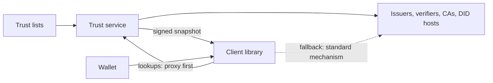

# Wallet Proxy

A trust layer for OpenID4VCI / OpenID4VP wallets and verifiers.

A **trust service** compiles trust lists of any kind (X.509 trust anchors for ISO mdoc / mDL, ETSI trusted lists,
OpenID Federation, EBSI, a plain registry) into one registry, signs a snapshot of it for each client, and proxies the
lookups a wallet needs about the parties it deals with: issuer metadata, DID documents, certificate revocation lists,
credential status lists, JSON-LD contexts.

A **client library** (`@vctrust/trust-client`) is how an app consumes it. Trust decisions are made on the device,
from the signed snapshot. Lookups go through the proxy first and fall back to the standard mechanism of each
specification when the proxy cannot serve. Without the service, only trust pinned in the app decides.



- [Architecture](docs/architecture.md): the registry, the snapshot, how a decision is made, the proxy, what happens
  when things fail, the security model, the evidence of conformance.
- [Configuration guide](docs/configuration.md): the service, the client library, the wallet core.
- [API description](docs/openapi.json) (also served at `/swagger-ui.html`).

## Repository

| Path | What |
| --- | --- |
| [`trust-server/`](trust-server) | The trust service: `trust-core` (registry, evaluator, X.509, DID), `trust-adapters` (trust list formats), `trust-server` (Spring Boot API). Java 21, Maven |
| [`packages/trust-client/`](packages/trust-client) | **The client library**, `@vctrust/trust-client`. TypeScript; Node, browsers, React Native. No platform crypto dependencies |
| [`packages/wallet-core/`](packages/wallet-core) | `@vctrust/wallet-core`: OpenID4VCI 1.0, OpenID4VP 1.0 and HAIP wallet logic with credential verification, on top of the library |
| [`apps/wallet/`](apps/wallet) | A demo wallet (Expo: Android, iOS, web) |
| [`test-ecosystem/`](test-ecosystem) | A reference issuer and verifier built on third-party implementations, to test against |
| [`conformance/`](conformance) | Shared test PKI, evaluation vectors both evaluators must agree on, credentials from real issuers |
| [`e2e/`](e2e), [`scripts/`](scripts) | UI tests; build, run and test helpers |

## Quick start

Needs JDK 21, Maven 3.9 and Node 22 (`. scripts/env.sh` loads a user-local toolchain from `~/.local/tools` when
there is one).

```sh
scripts/build.sh            # builds and tests the service; installs and builds the TypeScript packages
scripts/dev-up.sh           # trust service :8090, reference issuer :8791 and verifier :8792, listed in the service
```

Look at what a wallet gets:

```sh
curl -s localhost:8090/.well-known/trust-service                       # endpoints, the signing key thumbprint to pin
curl -s -H 'Authorization: Bearer demo-wallet-key' -H 'Accept: application/jwt' localhost:8090/api/v1/snapshot
curl -s -H 'Authorization: Bearer demo-wallet-key' 'localhost:8090/api/v1/issuers'
```

Run the demo wallet and give it a credential offer from the reference issuer:

```sh
npm run web -w @vctrust/wallet-app
curl -s localhost:8791/api/offers -H 'Content-Type: application/json' -d '{"configurationIds":["mDL_mso_mdoc"]}'
```

`scripts/dev-down.sh` stops everything.

## Using the library

```ts
import { createTrustClient } from '@vctrust/trust-client';

const trust = createTrustClient({
  service: { url: 'https://trust.example.org', clientId: 'wallet-app', apiKey: '...', keys: { thumbprints: ['...'] } },
});

// Decided on this device, from the signed snapshot:
const issuer = await trust.evaluateIssuer({ credentialIssuer: 'https://issuer.example.org', format: 'mso_mdoc', type: 'org.iso.18013.5.1.mDL' });
const signer = await trust.evaluate({ role: 'issuer', subject: { x5c }, context: { credentialFormat: 'mso_mdoc', credentialType: 'org.iso.18013.5.1.mDL' } });
const verifier = await trust.evaluateVerifier({ clientId, x5c, responseUri });

// Through the proxy, with the standard mechanism as fallback:
const metadata = await trust.getIssuerMetadata('https://issuer.example.org');
const did = await trust.resolveDid('did:web:issuer.example.org#key-1');
const status = await trust.checkTokenStatus({ idx, uri }, { signerX5c: x5c });
```

See [`packages/trust-client/README.md`](packages/trust-client/README.md).

### Where the library lives

The library is [`packages/trust-client`](packages/trust-client) of this repository: it is developed next to the
service because the two share their rules and are tested against each other
([`conformance/`](conformance)). It has no dependency on the rest of the repository at run time.

- Inside this repository it is an npm workspace: `@vctrust/trust-client`, and `@vctrust/trust-client/primitives` for
  its building blocks.
- For another project: `npm pack -w @vctrust/trust-client` builds an installable tarball. Pushing a tag
  `trust-client-v<version>` makes the `Release client library` workflow test, pack and attach that tarball to a
  GitHub release, from where it installs by URL. Publishing to a registry (`npm publish -w @vctrust/trust-client`)
  needs the `@vctrust` scope, or a rename to a scope you own.
- React Native (Metro) resolves the package through its `react-native` export condition, to the TypeScript sources.

## Tests

```sh
scripts/test-all.sh --offline     # everything that needs no network
scripts/test-all.sh               # plus the live suites (needs the internet and scripts/dev-up.sh)
```

| Suite | What it covers | Needs |
| --- | --- | --- |
| `trust-server` (JUnit) | Evaluator, X.509 and CRLs, DID drivers, list adapters, API, authentication, caches; generates and checks the evaluation vectors | nothing |
| `packages/trust-client` (Vitest) | The client: snapshot handling, proxy and fallback, strict parsers, the evaluation vectors | nothing |
| `packages/trust-client`, x509-limbo | X.509 path validation against the C2SP limbo suite | `LIMBO_JSON=$(sh packages/trust-client/scripts/fetch-limbo.sh)` |
| `test-ecosystem` (Vitest) | The reference issuer and verifier against their own third-party clients | nothing |
| `packages/wallet-core` (Vitest) | Strict credential verification, OpenID4VCI / OpenID4VP flows, the wallet against the reference ecosystem, credentials real issuers issued | nothing |
| `packages/wallet-core`, live | The wallet through the running trust service: reference ecosystem end to end; Animo playground; walt.id demo issuer (mDL, EUDI PID) | internet, `scripts/dev-up.sh` |
| `packages/trust-client`, live | Service and device decide alike, over HTTP | `scripts/dev-up.sh` |
| `e2e` (Playwright) | The demo wallet's UI | `scripts/dev-up.sh` |

## Status

This is a working reference implementation with a demonstration wallet (software keys, no user authentication). The
service and the library are written to be deployed; read the [production checklist](docs/configuration.md#production-checklist)
first. The specifications it implements, and what is checked against what, are listed in the
[architecture guide](docs/architecture.md#conformance).

## License

[MIT](LICENSE).
