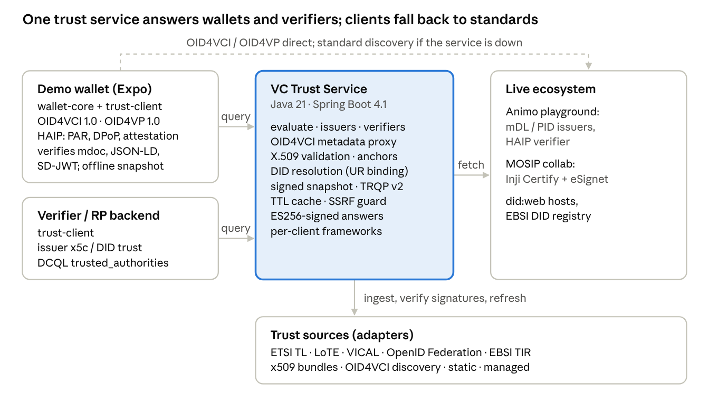

# VC Trust Service — Design

Nov 1, 2026 · Living version: https://claude.ai/artifact/RViVpaEWce3S8yctArPdvk

## Overview and goals

The VC Trust Service gives OpenID4VCI/OpenID4VP wallets and verifiers one place to ask "should I trust this party?" and to fetch the material they need to check it. That material is issuer lists and metadata, X.509 chains (mdoc IACA, SD-JWT VC issuers, verifier access certificates) and DID documents. It is a Java 21 / Spring Boot server plus a TypeScript client library. A demo React Native wallet exercises both against live public issuers.

**Problems it solves**

- Every wallet re-implements trust: it hard-codes IACA roots and issuer allowlists, and parses a different list format per ecosystem.
- Trust information is scattered across incompatible formats: ETSI TS 119 612 / 119 602 lists, ISO 18013-5 VICALs, OpenID Federation, EBSI TIR, plain PEM bundles and DID methods.
- Mobile wallets pay for repeated metadata and DID fetches. They also leak which issuers and verifiers the user talks to.

**Goals**

1. **Spec-agnostic core.** Ingest any trust-list format through adapters into one normalized model, and answer through one decision API, plus standard bindings such as ToIP TRQP and the Universal Resolver path.
2. **Proxy and cache.** Serve validated OID4VCI issuer metadata, X.509 path validation and DID resolution with caching, SSRF protection and signed responses.
3. **Per-client policy.** Each configured wallet or verifier sees only the frameworks and trust anchors its profile accepts.
4. **Fail-safe fallback.** When the service is unreachable, the client library falls back to standard mechanisms: direct `.well-known` fetches, local DID resolution, and local path validation against a signed offline snapshot. It never silently upgrades an unknown party to trusted.
5. **First-class formats.** W3C VCDM 2.0 JSON-LD (`ldp_vc`) and ISO mDL (`mso_mdoc`) are primary. SD-JWT VC and JWT VC are supported where needed.

**Non-goals**

- Issuing credentials. The demo uses public online issuers.
- Being a production wallet. The demo wallet is protocol-compliant but throwaway.
- Revocation-status hosting. The service resolves status where a source provides it, but runs no status lists of its own.

**Design principles**

- Decisions carry evidence: chain, anchor, source list, framework and expiry. A client can show *why* a party is trusted.
- Three-valued outcome: `TRUSTED`, `NOT_TRUSTED`, `UNKNOWN`. Fallback paths can reach `TRUSTED` only through locally pinned anchors or a verified snapshot.
- Pluggable everywhere: sources, DID drivers, certificate profiles, HTTP, crypto and storage.

## Standards landscape and compatibility

Every trust-list format enters through an adapter, and every protocol touchpoint maps onto one decision API. Versions are the ones in force on 2026-11-01.

| Standard | Version | Role in the service | Where |
| --- | --- | --- | --- |
| [OpenID4VCI](https://openid.net/specs/openid-4-verifiable-credential-issuance-1_0.html) | 1.0 Final (Sep 2025) | Issuer metadata proxy: well-known insertion rule, `credential_issuer`/AS `issuer` checks, `oid4vci-discovery` source | Server, client, wallet |
| [OpenID4VP](https://openid.net/specs/openid-4-verifiable-presentations-1_0.html) | 1.0 Final (Jul 2025) | Verifier trust: all client\_id prefixes; DCQL `trusted_authorities` (`aki`, `etsi_tl`, `openid_federation`) | Server, client, wallet |
| [HAIP](https://openid.net/specs/openid4vc-high-assurance-interoperability-profile-1_0.html) | 1.0 Final (Dec 2025) | Wallet profile: PAR, PKCE, DPoP nonces, wallet and key attestation, `x509_hash`, `direct_post.jwt` | Wallet |
| ISO/IEC 18013-5 | 1st ed. + VICAL | IACA trust domain, Document Signer profile (EKU 1.0.18013.5.1.2, country match), `vical` source | Server, client |
| W3C VCDM 2.0 + Data Integrity | REC | JSON-LD credential verification; issuer DID trust | Wallet, client |
| SD-JWT VC | draft-13 (HAIP pin) | `x5c` issuer chains (`credential-issuer` domain) | Server, client |
| W3C DID Resolution | CR Draft (Oct 2026) | Proxy and Universal-Resolver-compatible API; did:web, did:key, did:jwk native; RFC 9457 error types | Server, client |
| [OpenID Federation](https://openid.net/specs/openid-federation-1_0.html) | 1.0 Final (Feb 2026) | `openid-federation` source: chain validation, metadata policy, trust marks, on-demand resolution | Server |
| ETSI TS 119 612 | v2.4.1 | `etsi-tl` source: EU LOTL and national TLs, XMLDSig/XAdES signer check | Server |
| ETSI TS 119 602 (LoTE) | v1.1.1 | `etsi-lote` source: PID, wallet, WRPAC, WRPRC and Pub-EAA lists, JAdES signer check | Server |
| EBSI TIR | v5 | `ebsi-tir` source: crawl or on-demand by DID; accreditation types become authorizations | Server |
| [ToIP TRQP](https://trustoverip.github.io/tswg-trust-registry-protocol/approved/) | v2.0 approved | Standard query binding: `POST /trqp/authorization`, `/trqp/recognition` | Server |

Two live ecosystems shape the defaults. **Animo's playground** (Credo) is fully OpenID4VCI 1.0 / HAIP shaped and anchors mdoc trust in a published root. **MOSIP collab (Inji Certify)** issues VCDM 2.0 JSON-LD with `Ed25519Signature2020`. Its deviations are handled explicitly rather than papered over:

- the signing key's DID differs from the `issuer` DID;
- `assertionMethod` lists the bare DID;
- the mDL is non-ISO (non-standard wrapping, no DS EKU).

## System architecture



Wallets and verifiers embed the client library and ask the service; the service ingests trust lists and fetches live metadata on their behalf. When it is unreachable, the client talks to issuers directly and decides from its signed snapshot.

**Request flows**

1. **Receive a credential.** The wallet resolves the offer and calls `getIssuerMetadata`: the proxy validates, curates and caches the metadata and attaches the issuer decision. The wallet then runs OpenID4VCI with the issuer. It verifies each credential and evaluates its issuer (x5c chain or DID key) through the service.
2. **Present.** The wallet verifies the request object signature and `client_id` binding locally, then asks the service whether the verifier is trusted (x5c chain to a verifier-access CA, registry entry, `response_uri` rule). It shows the decision before the user consents.
3. **Offline.** The client detects the outage (timeout or open circuit), uses cached answers and the verified snapshot, resolves did:key, did:jwk and did:web itself, and validates chains locally. Each decision is marked with its source.

**Deployment.** The server is one stateless jar plus a small database (H2 by default, PostgreSQL mode) holding admin-managed entries. Replicas share nothing but configuration; each loads sources independently. The demo runs everything on one laptop, against the public Animo and MOSIP sandboxes.

## Normalized trust model

All sources reduce to two record types, **trusted entities** and **trust anchors**, grouped by framework and served to clients through per-client profiles. Everything else is evidence.

| Concept | What it holds | Notes |
| --- | --- | --- |
| `TrustFramework` | id, name, governance URI | One per ecosystem, e.g. `animo-playground`, `mosip-collab`, `eu-lotl` |
| `TrustedEntity` | id, framework, roles, identifiers, display, authorizations, status, validity, certificates, metadata, metadata policy, provenance | Entities sharing an id across sources are merged; the most restrictive status wins |
| `EntityRole` | `CREDENTIAL_ISSUER`, `VERIFIER`, `WALLET_PROVIDER`, `AUTHORIZATION_SERVER`, `ACCREDITATION_AUTHORITY`, `STATUS_LIST_PROVIDER` | Protocol neutral |
| `Identifier` | typed, normalized value: `DID`, `URL`, `CLIENT_ID`, `DNS`, `X509_SHA256`, `X509_SKI`, `X509_SUBJECT`, `JWK_THUMBPRINT`, `FEDERATION_ENTITY` | Indexed for O(1) lookup |
| `CredentialAuthorization` | format + type (doctype, vct or VC type) | What an issuer may issue or a verifier may request |
| `TrustAnchor` | X.509 certificate in a `TrustDomain`, optional entity link, constraints (`docTypes`, `serviceType`, `trustedListUri`) | Validating a chain to an anchor identifies the entity |
| `TrustDomain` | `mdoc-iaca`, `credential-issuer`, `verifier-access`, `wallet-provider`, `status-list`, `list-signer`, ... | Purpose isolation, each with its own certificate profile |
| `ClientProfile` | accepted frameworks, strict authorization flag, metadata-proxy openness | Each configured wallet or verifier sees only its frameworks |
| `Provenance` | source id and type, list URI, retrieval time | Carried into every decision |

**Metadata policy.** The OpenID Federation operators (`value`, `add`, `default`, `one_of`, `subset_of`, `superset_of`, `essential`) are the one way to curate metadata. Federation chains use them, and so can a registry entry. For example, it can declare the pre-authorized token endpoint an issuer forgets to advertise.

**Registry snapshots.** Sources load independently on their own refresh interval or the list's `nextUpdate`. A failing source keeps its last good result. Every load publishes a new immutable, fully indexed snapshot; lookups never see a partial registry, and the snapshot version doubles as the HTTP ETag.

**Decision semantics.** A query is `role + subject + context`:

- **Subject:** identifier, `x5c`, JWK and/or kid.
- **Context:** protocol, format, type, `response_uri`, `trusted_authorities`.

Each supplied element is checked independently:

- **Contradicting evidence gives `NOT_TRUSTED`:** an invalid chain, a revoked entity, an unauthorized type, a key missing from the DID document, or an `x509_hash` mismatch.
- **Otherwise, a registry match or a validated anchor gives `TRUSTED`.**
- **Otherwise the result is `UNKNOWN`.**

## Server design (Java 21, Spring Boot 4.1)

The server is three Maven modules with a strict dependency direction: `trust-core` (no Spring) ← `trust-adapters` ← `trust-server`. Core and adapters can be embedded in other JVM services.

| Module | Responsibility | Key types |
| --- | --- | --- |
| `trust-core` | Domain model, SPIs, evaluation engine, X.509, DID, metadata | `TrustEvaluator`, `X509PathValidator`, `CertificateProfiles`, `DidResolver`, `IssuerMetadataResolver`, `MetadataPolicy`, `TrustSourceManager`, `RegistrySnapshot` |
| `trust-adapters` | One adapter per list format, discovered via `ServiceLoader` | `static`, `x509-bundle`, `oid4vci-discovery`, `etsi-tl`, `etsi-lote`, `vical`, `openid-federation`, `ebsi-tir` |
| `trust-server` | HTTP API, auth, caching, signing, SSRF-safe fetching, managed (JDBC) source | controllers, `SafeHttpFetcher`, `TtlCache`, `ServiceKeyManager`, `ManagedSourceFactory` |

**Extension points (SPIs)**

- `TrustSourceFactory` / `TrustSource`: a new list format is one class plus a `META-INF/services` line. Sources return entities, anchors and `ListInfo` (sequence, `nextUpdate`, signature status).
- `OnDemandResolver`: optional, for registries too large to enumerate (OpenID Federation bottom-up chain resolution, EBSI lookup by DID).
- `DidMethodDriver`: did:key, did:jwk and did:web are native. A generic `http-registry` driver takes a URL template (EBSI is configured this way). A Universal Resolver driver covers the rest.
- `CertificateProfile`: purpose checks on top of RFC 5280 PKIX (ISO 18013-5 Document Signer, credential issuer, verifier access). Anchors can carry `relaxProfile` for known-deviant sandboxes, which turns errors into visible warnings.
- `HttpFetcher` / `ResourceLoader`: all I/O goes through these, so adapters never open sockets.

**Evaluation pipeline** (`TrustEvaluator`):

1. Derive identifiers. This parses OpenID4VP client\_id prefixes and DIDs from kid, and computes JWK and certificate thumbprints.
2. Validate the chain against the role/format trust domain, filtered to the client's frameworks.
3. Match the registry; validated SAN names count only after the chain validates.
4. Fall back to on-demand sources.
5. Run DID document checks (verification method present, relationship).
6. Check status, validity and authorization.
7. Apply the OpenID4VP `response_uri` host rule, then DCQL `trusted_authorities` matching.
8. Combine into `TRUSTED`, `NOT_TRUSTED` or `UNKNOWN` with reasons and evidence.

**Operational qualities**

- *Caching:* a TTL cache honours upstream `max-age`, collapses concurrent loads, caches negative DID results for 1 minute and serves stale data for up to 24 hours when an upstream is down. Registry changes invalidate curated metadata.
- *SSRF:* https only, except allow-listed dev hosts. Private, loopback, link-local, CGNAT and ULA targets are refused. Redirects are re-validated hop by hop, and bodies are capped at 8 MiB.
- *Hardened parsing:* XML forbids DOCTYPE and entities. XMLDSig uses secure validation. JWS and COSE algorithms are explicit.
- *Integrity:* an ES256 service key (JWKS published, thumbprint in discovery) signs snapshots and, on `Accept: application/jwt`, any response. Signed output is audience-bound to the client.
- *Availability:* sources load off the startup thread, and `/actuator/health` reports per-source state. A failing source keeps serving its last good data.

Test coverage: 61 tests (core 36, adapters 16, server 9). They use generated PKIs, a signed federation and VICAL, an XMLDSig-signed TL, a JAdES LoTE and the live EU LOTL as a fixture.

## Server API

All endpoints are discoverable from `/.well-known/trust-service`. Clients authenticate with `Authorization: Bearer <api-key>`, and the key selects a client profile; anonymous access is configurable. Errors are RFC 9457 problem details with a stable `code`. Registry reads carry ETags (`304` on `If-None-Match`). Any JSON endpoint returns a service-signed JWT on `Accept: application/jwt`.

| Method and path | Purpose | Notes |
| --- | --- | --- |
| `GET /.well-known/trust-service`, `/.well-known/jwks.json` | Discovery, service keys | Thumbprint for pinning |
| `GET /api/v1/frameworks` | Accepted frameworks with counts |  |
| `GET /api/v1/issuers`, `/verifiers`, `/entities` | Paged lists; filter by `framework`, `format`, `type`, `q` | `format=mso_mdoc&type=org.iso.18013.5.1.mDL` |
| `GET /api/v1/entities/lookup?identifier=` | Find entities by URL, DID or client\_id |  |
| `GET /api/v1/entities/{id}` | Entity, metadata, policy, linked anchors |  |
| `GET /api/v1/issuers/metadata?credential_issuer=` | OpenID4VCI metadata proxy | Validated, policy-curated, cached; trust decision embedded; `X-Trust-Decision` header |
| `POST /api/v1/evaluate`, `/evaluate/batch` | Trust decision for any role, subject and context | Batch max 50 |
| `POST /api/v1/x509/validate` | Chain validation in a trust domain | Optional `docType`, `expectedDnsName` |
| `GET /api/v1/x509/anchors?domain=&format=pem` | Anchor export | JSON or PEM bundle |
| `GET /api/v1/did/{did}` | W3C DID resolution result | Raw-path parsing keeps `%3A`; cache info in metadata |
| `GET /1.0/identifiers/{did}` | Universal Resolver / DID Resolution HTTP binding | `Accept` picks result or document; spec status codes |
| `GET /api/v1/snapshot` | Signed offline snapshot (`trust-snapshot+jwt`) | Per-client scope, ETag, 24 h TTL |
| `POST /trqp/authorization`, `/trqp/recognition` | ToIP TRQP v2.0 | `authority_id` names a framework; `resource` may be `format:type` |
| `/admin/v1/sources`, `/sources/{id}/refresh`, `/registry`, `/managed/{entities,anchors}/{id}`, `/cache/clear` | Operator API | Admin client only |

A decision response looks like this, abridged:

```json
{"decision":"TRUSTED","summary":"Trusted credential issuer 'MOSIP Land Registry (collab)' in framework 'mosip-collab'",
 "reasons":[{"code":"did.relationship_lenient","severity":"WARNING"}],
 "entity":{"id":"mosip-land","frameworkId":"mosip-collab","roles":["CREDENTIAL_ISSUER"]},
 "evidence":{"x509":null,"did":{"did":"did:web:inji.github.io:...","verificationMethodFound":true,"relationshipValid":true},
             "authorization":{"format":"ldp_vc","type":"LandStatementCredential","authorized":true}},
 "validUntil":"...","source":"trust-service"}
```

## Client library (TypeScript)

`@vctrust/trust-client` gives wallets and verifiers one API, `TrustClient`. Every call follows the same chain: the trust service, then (only when it is unreachable) cached service answers, the verified offline snapshot, and standard mechanisms. The library has no Node-only dependencies (noble crypto plus its own CBOR, DER and X.509 code), so the same build runs in Node, browsers and React Native/Hermes.

| Layer | Responsibility |
| --- | --- |
| `TrustClient` facade | `evaluate`, `evaluateIssuer`, `evaluateVerifier`, `evaluateCredential`, `getIssuerMetadata`, `resolveDid`, `validateChain`, `issuers`, `verifiers`, `lookup`, `syncSnapshot`, `status` events |
| Transport | Timeouts, retries with jittered backoff (idempotent calls only), a circuit breaker, RFC 9457 errors, online/offline status |
| Cache | Pluggable `CacheStore` (memory, or a localStorage/AsyncStorage adapter); service answers are kept for offline reuse |
| Snapshot manager | Fetches `trust-snapshot+jwt`, verifies it against service keys pinned by RFC 7638 thumbprint (TOFU optional), checks audience and expiry, persists it, and serves it offline within a grace period (default 7 days) |
| Local evaluator | Mirrors the server's decision semantics over the snapshot plus app-bundled anchors and entities |
| Standards fallback | OpenID4VCI 1.0 discovery (insertion rule, `credential_issuer` and AS `issuer` checks); did:key, did:jwk and did:web; local RFC 5280 path validation with the same profiles (EC, Ed25519, RSA PKCS#1 and PSS) |
| Credential helpers | Issuer material per format: mdoc IssuerSigned (including MOSIP's wrapper), SD-JWT VC, JWT VC, JSON-LD VC |

**Fallback semantics.**

- Only `TrustServiceUnavailableError` (network failure, timeout, 5xx, open circuit) triggers fallback. Policy answers such as a `403` for an unregistered issuer are never bypassed.
- Integrity failures throw: a bad snapshot signature or a wrong audience is never silently ignored.
- Every decision carries `source` (`trust-service`, `snapshot`, `fallback`) and a `fallback.*` reason. A fallback decision can be `TRUSTED` only with a verified snapshot or a pinned anchor; otherwise it is `UNKNOWN`.

```ts
const trust = createTrustClient({
  baseUrl: 'https://trust.example', apiKey, clientId: 'demo-wallet',
  serviceKeys: { thumbprints: ['WwQ91FCw...'] },
  cache: new KeyValueCacheStore(AsyncStorage),
  fallback: { localAnchors: [{ domain: 'mdoc-iaca', certificate: IACA_PEM }] },
});
const { decision } = await trust.evaluateCredential(mdocB64, 'mso_mdoc', { credentialIssuer });
```

Test coverage: 34 unit tests (real MOSIP and Animo artefacts, generated EC and RSA PKI, Node-generated JWS/EdDSA/RSA-PSS, RFC 7638 vector, full fallback matrix).

## Demo wallet

The wallet is a throwaway Expo app over `@vctrust/wallet-core`, a platform-neutral holder library. All protocol logic and verification live in wallet-core and are tested against live issuers and verifiers. The app is only UI.

| Area | Implemented (spec) |
| --- | --- |
| Issuance flows | Pre-authorized code with `tx_code`; authorization code with PKCE S256, PAR when offered (FAPI2: only `client_id` + `request_uri` at `/authorize`), RFC 9207 `iss` check; wallet-initiated issuance (OID4VCI 1.0) |
| HAIP issuance | DPoP (RFC 9449) with per-server nonces and `use_dpop_nonce` retries at AS and issuer; wallet attestation (ABCA-07, -12 compatible) with challenge endpoint; key attestation (`key-attestation+jwt`), with a precheck that refuses when the issuer demands stronger key storage than the wallet attests |
| Credential request | Nonce endpoint and `invalid_nonce` retry; `credential_identifier` vs `credential_configuration_id`; `proofs.jwt`; holder binding by `jwk`/`cose_key`, `did:jwk` or `did:key`; deferred issuance; notification |
| Verification: mdoc | COSE\_Sign1 with the DS key; every IssuerSignedItem digest; `validityInfo`; docType; `deviceKey` = holder key; DS chain to IACA via the trust client. Non-standard encodings become explicit warnings |
| Verification: VCDM 2.0 JSON-LD | `Ed25519Signature2020`, `eddsa-rdfc-2022`, `ecdsa-rdfc-2019` over RDFC-1.0 with bundled contexts; safe mode (undefined terms are reported as unsigned); issuer key control, including key equivalence across DIDs; `assertionMethod`; validity; holder `did:jwk`; Bitstring Status List |
| Verification: SD-JWT VC | x5c, DID kid or `jwt-vc-issuer` key resolution; disclosure digests and rejection of unreferenced disclosures; `cnf`; Token Status List |
| Presentation (OID4VP 1.0 / HAIP) | `request_uri` (GET, or POST with `wallet_metadata` and `wallet_nonce`); JAR `typ` and signature checks; `x509_hash`, `x509_san_dns`, `decentralized_identifier`, `redirect_uri`; verifier trust via the trust client; DCQL (`credential_sets`, `claim_sets`, `values`, `trusted_authorities`); SD-JWT+KB; mdoc DeviceResponse with OpenID4VPHandover; ldp\_vp; `direct_post` and `direct_post.jwt` (ECDH-ES P-256, A128GCM/A256GCM) |

**Use of the client library.**

- Issuer metadata always comes through `trust.getIssuerMetadata`: the proxy with curation and an embedded decision, or direct discovery when offline.
- DID documents (JSON-LD verification methods, SD-JWT DID kids) go through `trust.resolveDid`.
- Each received credential's issuer is evaluated with its x5c, kid and type.
- Verifiers are evaluated with client\_id, x5c and `response_uri`.

The app shows the decision and its source next to every credential and request.

**Issuer quirks are configuration, not code.** MOSIP collab needs a pre-registered client and Mimoto's token proxy. Those are expressed as an `IssuerClientRegistration` (client\_id, redirect\_uri, token endpoint override).

## Security considerations

The service is a policy decision point that wallets act on, so its answers must be authentic, scoped, and never fail open.

| Threat | Mitigation |
| --- | --- |
| Forged or replayed trust answers | Snapshots and opt-in responses are ES256 JWTs from the service key, audience-bound to the client; clients pin the key by RFC 7638 thumbprint; TLS in transit |
| Fallback that fails open | Fallback runs only on unavailability, never on policy errors. Offline `TRUSTED` needs a verified snapshot or a pinned anchor; otherwise `UNKNOWN`. Every decision carries `source` |
| Tampered or stale trust lists | XMLDSig/XAdES (ETSI TL), JAdES (LoTE), COSE (VICAL) and federation chains are verified against pinned anchors. Expired LoTEs are rejected; `nextUpdate` drives refresh; a failing source keeps its last good data and the failure shows in health |
| SSRF through the metadata or DID proxy | https only; private, loopback, link-local, CGNAT and ULA targets refused (DNS-resolved, re-checked per redirect hop); 8 MiB cap; timeouts; strict clients can forbid proxying unregistered issuers. Residual risk: DNS rebinding between check and connect |
| Cross-purpose trust | Anchors are partitioned by trust domain (IACA, credential issuer, verifier access, wallet provider, status list), each with its own certificate profile |
| Malicious XML / CBOR / JSON | DOCTYPE and external entities disabled, XMLDSig secure validation; size-capped inputs; explicit algorithm allow-lists (no `alg: none`) |
| Verifier impersonation | JAR `typ` and signature checks, `x509_hash` / SAN binding, `response_uri` host rule for `x509_san_dns`, `client_id` equality between query and request object, trusted verifier-access CA |
| Credentials borrowing trust | The issuer query uses the identifier inside the credential (`iss`/`issuer`), not the endpoint that delivered it; for JSON-LD the issuer must control the signing key |
| Context substitution (JSON-LD) | Standard contexts are bundled; remote fetches are https-only and flagged; safe-mode canonicalization flags terms not covered by the signature |
| Privacy | The proxy hides wallet IPs from issuers and DID hosts; snapshots enable offline decisions without per-credential calls; the server logs no credential contents |

The API is authenticated by API key mapped to a client profile; the admin API needs an admin client. Production should front it with mTLS or OAuth client credentials and rate limiting, and keep the signing key in an HSM/KMS (the demo uses a JWK file).

## Testing strategy and results

Testing runs in three layers.

1. **Deterministic suites:** 61 Java, 34 trust-client and 14 wallet-core tests. They use generated PKIs, signed fixtures, spec test vectors and real artefacts.
2. **Live end-to-end suites:** wallet-core against public issuers and verifiers through a running trust service.
3. **Playwright UI tests** of the Expo web build.

No local issuer is used; every credential below was issued by a live third-party service.

| Scenario (live) | Spec features exercised | Result |
| --- | --- | --- |
| Animo mDL, pre-authorized code | OID4VCI 1.0, insertion well-known, nonce endpoint, `jwk` proof | valid, TRUSTED (DS → Animo IACA) |
| Animo mDL with DPoP, PIN, and DPoP + wallet attestation + key attestation | HAIP issuance (RFC 9449, ABCA, key attestation) | valid, TRUSTED |
| Animo mDL, sign-in | PAR, PKCE S256, FAPI2 `request_uri`, RFC 9207 `iss` | valid, TRUSTED |
| Animo mDL, deferred 1 min | 202 + `transaction_id`, deferred endpoint with DPoP | issued after 62 s |
| Key attestation demanding `iso_18045_high` | `key_attestations_required` precheck | refused before request |
| Animo EUDI PID SD-JWT VC | x5c issuer chain, disclosures, `cnf` | valid, TRUSTED |
| Present mDL and SD-JWT to the Animo verifier | OID4VP 1.0: `x509_hash`, `request_uri`, DCQL, DeviceResponse with handover, KB-JWT, `direct_post.jwt` A256GCM | verifier `ResponseVerified` |
| MOSIP Farmer VCDM 2.0 JSON-LD | Authorization code + PKCE via eSignet, `did:jwk` binding, Ed25519Signature2020, did:web | valid, TRUSTED (warnings for undefined terms) |
| MOSIP Land VCDM 2.0 JSON-LD | Same | signature invalid (issuer defect; Digital Bazaar library agrees) |
| MOSIP mock mDL | Non-ISO mdoc | valid, TRUSTED via `relaxProfile`; four deviations flagged |
| Outage with a synced snapshot | Fallback: direct discovery, local did:web, local X.509, snapshot decisions, circuit-breaker recovery | issuance and presentation work; source `snapshot` |
| Outage without a snapshot | Fallback must not fail open | verified; trust `UNKNOWN` |
| Wallet web UI (Playwright) | Settings and snapshot, mDL issue and present, outage fallback; MOSIP JSON-LD (opt-in) | pass |

The offline suites include spec vectors, so wire formats are checked byte for byte:

- the OpenID4VP 1.0 B.2.6.1 SessionTranscript;
- RFC 7518 Appendix C ECDH-ES Concat KDF;
- RFC 7638 thumbprint;
- the did:key P-256 vector;
- the RFC 9901 disclosure digest.

They also parse the live EU LOTL (sequence 397).

## Operations and configuration

One `application.yml` drives everything: frameworks, sources, clients, HTTP limits, caches and DID drivers. The full reference is `docs/configuration.md` in the repository.

**Running locally**

```sh
scripts/build.sh                # mvn install (61 tests) + npm builds
scripts/start-trust-server.sh   # :8090, loads Animo / MOSIP / EBSI sources
scripts/test-all.sh             # offline suites, then live end-to-end (internet)
```

**Observability.**

- `/actuator/health` reports a `trust` component with per-source state and registry counts. It is DOWN until the first load completes.
- `/admin/v1/sources` shows the last attempt and success, errors, counts, `ListInfo` (sequence, `nextUpdate`, signature status) and the next refresh.
- `/admin/v1/registry` gives counts by framework, role and trust domain.
- Micrometer metrics are on `/actuator/metrics`.

**Extending.**

- *New list format:* one `TrustSourceFactory` plus a `META-INF/services` line.
- *New DID method:* either an `http-registry` template in config or a `DidMethodDriver`.
- *New certificate profile:* a `CertificateProfile` bound to a trust domain.
- *Client storage:* any `KeyValueStorage` (AsyncStorage, localStorage).

**Roadmap and open questions**

- [ ] Production auth: mTLS or OAuth client credentials instead of static API keys; signing key in HSM/KMS.
- [ ] Status checks in the service (Token Status List and Bitstring); today the wallet checks status itself.
- [ ] Pin the IP between DNS check and connect, to close the residual DNS-rebinding window in the SSRF guard.
- [ ] Signed issuer metadata (`openidvci-issuer-metadata+jwt`) is verified when served; decide whether HAIP ecosystems should require it.
- [ ] DC API (`dc_api.jwt`) presentation in the wallet; the decision engine already supports the `origin:` client\_id prefix.
- [ ] Report MOSIP collab defects upstream: the Land signature, the pre-auth token audience and the mdoc encoding.
