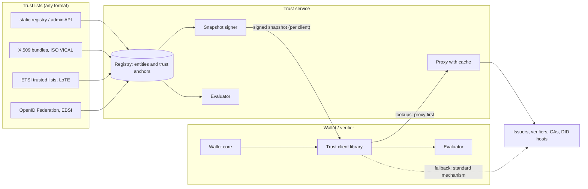

# Architecture

Wallet Proxy is a trust layer for OpenID4VCI / OpenID4VP wallets and verifiers. It has two halves:

- a **trust service** (Java 21, Spring Boot): compiles trust lists of any kind into one registry, signs a snapshot of
  it for each client, and proxies the lookups a wallet needs about issuers and verifiers (issuer metadata, DID
  documents, X.509 revocation lists, credential status lists, JSON-LD contexts);
- a **client library** (`@vctrust/trust-client`, TypeScript): the only way an app talks to the service. It makes
  every trust decision on the device from the signed snapshot, sends lookups through the proxy first, and uses the
  standard mechanism of each specification when the proxy cannot serve.

A demo wallet (`@vctrust/wallet-core` and `apps/wallet`) consumes trust only through the library, and a reference
issuer and verifier (`test-ecosystem/`) built on third-party implementations give everything something spec-compliant
to be tested against.

## Principles

1. **The service compiles, the client decides.** The service turns lists into a registry and hands each client a
   signed snapshot of what that client may trust. Whether a given issuer or verifier is trusted is decided on the
   device, from the snapshot. The service is not asked "is X trusted?", so it does not learn whom a user deals with,
   and a decision does not need the network.
2. **One set of rules, two implementations, checked against each other.** The service's evaluator (Java) is the
   reference. The library's evaluator (TypeScript) must reach the same outcome from the same data. Shared vectors
   generated by the service make a difference between the two a failing test on both sides (see
   [Conformance](#conformance)).
3. **Proxy first, standards as fallback.** Lookups go through the service because it caches, hides the device from
   the looked-up party and can sign what it relays. Nothing depends on it: every lookup has a standard mechanism,
   and the library uses it when the proxy is down, declines, or answers with something that does not verify.
4. **Nothing is trusted because of where it came from.** Everything relayed is verified against a key the device
   already trusts: the snapshot and signed proxy responses against the pinned service key, CRLs and status lists
   against their own signers, JSON-LD contexts against digests in the snapshot.
5. **Missing data never produces trust.** Without a usable snapshot only trust pinned in the app decides; without
   that, the answer is `UNKNOWN`. A fallback fetches; it does not vouch.
6. **Strict by default.** What a specification says must be refused is refused, on the service, in the library and
   in the wallet. There is no "lenient mode".

## Components

| Path | What | Notes |
| --- | --- | --- |
| `trust-server/trust-core` | Registry model, evaluator, X.509 path validation, CRLs, DID drivers, metadata policy | No Spring; the rules live here |
| `trust-server/trust-adapters` | Trust list formats (`TrustSourceFactory` SPI) | static, managed, x509-bundle, vical, etsi-tl, etsi-lote, openid-federation, ebsi-tir, oid4vci-discovery |
| `trust-server/trust-server` | REST API, snapshot signing, proxy caches, client authentication, admin API | Spring Boot application |
| `packages/trust-client` | The client library | Main entry: the client. `@vctrust/trust-client/primitives`: the parsers and verifiers it is made of |
| `packages/wallet-core` | OpenID4VCI 1.0 / OpenID4VP 1.0 / HAIP wallet core; credential verification | Uses the trust client for every external fact |
| `apps/wallet` | Demo wallet (Expo: Android, iOS, web) | Throwaway UI over wallet-core |
| `test-ecosystem` | Reference issuer and verifier | Built on `@openid4vc/*`, Digital Bazaar, `@owf/mdoc`, `@sd-jwt/*` |
| `conformance` | Shared test PKI, evaluation vectors, real-world credentials | Read by the Java and the TypeScript tests |

## The registry

Every trust list is mapped into two kinds of records.

**Entities** are parties: who they are (`identifiers`), what they are (`roles`: credential issuer, verifier, wallet
provider, ...), whether they are in good standing (`status`, validity), what they may issue or request
(`authorizations`: format and type), how to show them (`display`), their pinned certificates, and optional metadata
policy (OpenID Federation operators).

**Trust anchors** are CA certificates, each in a **trust domain** that says what its chains are for:

| Domain | Chains of |
| --- | --- |
| `mdoc-iaca` | ISO 18013-5 Document Signers (the anchor is the IACA) |
| `credential-issuer` | SD-JWT VC and signed-metadata signers (`x5c`) |
| `verifier-access` | OpenID4VP request signers (`x509_hash`, `x509_san_dns`) |
| `wallet-provider`, `status-list` | wallet attestations, status list signers |

An anchor can belong to one entity (`entity`): a chain that validates to it then *is* that entity. An anchor shared
by many parties has no entity, and vouches only that a certificate is valid; who the certificate belongs to must
come from the registry (see step 2 of [How a decision is made](#how-a-decision-is-made)). Anchors carry constraints: the
doctypes an IACA may sign, where its CRL is published, or a CRL pushed by the operator.

Entities and anchors belong to a **framework** (a trust scheme). A client sees the frameworks its profile names
and nothing else.

Sources load on a schedule. The service is not ready, and serves no snapshot (`503 not_ready`), until every
required source has loaded once: a client must never mistake a half-loaded registry for the whole. A source that
later fails keeps its last content; a list that cannot be authenticated (an unsigned trusted list, an unpinned
remote certificate bundle) is not loaded unless the operator says so explicitly.

## The snapshot

`GET /api/v1/snapshot` returns a JWT (`typ: trust-snapshot+jwt`, ES256) for the calling client:

| Claim | Content |
| --- | --- |
| `iss`, `aud`, `iat`, `exp` | The service, the client it is for, validity (default 24 h) |
| `format` | Layout version (4). A client refuses a layout it does not read |
| `policy` | The client's profile: `frameworks`, `strictAuthorization`, `requireRevocationStatus`, `requireSignedIssuerMetadata` |
| `frameworks`, `entities`, `anchors` | The registry as this client may see it |
| `didDocuments` | DID documents of the listed DID identifiers, resolved by the service |
| `contexts` | JSON-LD contexts the listed parties use: `{url: {sha256, document?}}` |
| `crls` | Current CRLs of the trust anchors, each signed by its CA |

The `ETag` is a digest of the content, so a client polling with `If-None-Match` gets `304` until something it can
see actually changes. The library:

- verifies the signature with keys **pinned by thumbprint** (trust on first use exists for development only), the
  audience, the format and the dates; a snapshot dated in the future is refused;
- never replaces a snapshot with an older one (rollback protection);
- stores it, re-verifies it when loaded, refreshes it in the background (default hourly), and keeps using it for a
  grace period after it expires (default 7 days), marking every decision `snapshot.stale`.

## How a decision is made

The same steps run in `TrustEvaluator` (Java) and `LocalEvaluator` (TypeScript). A query names a role (issuer or
verifier), what the subject claims to be (`identifier`), the key its signature was verified with (an `x5c` chain, a
DID key or a JWK) and context (format, credential type, `response_uri`, `trusted_authorities`).

1. **The chain.** An `x5c` chain is validated against the anchors of the role's trust domain: path building,
   validity, CA and path-length constraints (also on the anchor), key usage, the certificate profile of the domain,
   the anchor's doctype constraint, and revocation against the CRLs at hand. ISO 18013-5 Annex B (the mDL signer's
   extended key usage and country) is applied to mDL documents; other doctypes are issued under other profiles.
2. **The entity.** With key material, an entity is found only through what the
   key proves: the names of a validated certificate (subject, subject key identifier, DNS and URI names), the hash
   of the leaf certificate (a pin), the DID of a DID key, a JWK thumbprint, a certificate pinned on the entity, the
   entity its anchor belongs to, or a client identifier that the key itself proves (`x509_hash` of the leaf,
   `x509_san_dns` naming a validated leaf, `decentralized_identifier` of the key's DID). Without key material the
   identifier is a registry lookup.
3. **The claim.** With key material the identifier is only a claim. If it names a registered party and the key is
   not bound to that party, the answer is `NOT_TRUSTED` (`identifier.unbound`): a certificate under a shared CA
   cannot borrow the name of another member of that CA.
4. **Standing and scope.** The entity must have the role, be active and within its validity, and be authorized for
   the credential's format and every type it asserts. A strict client profile also refuses entities that list no
   authorizations. When a key is bound to several registered parties, the one meant does not depend on the order
   they are listed in: the entity the anchor belongs to; else, by entity id, the first in good standing that is
   authorized for what is asked.
5. **DIDs.** The key must be in the DID document and listed under the right relationship (`assertionMethod` for
   issuers, `authentication` for verifiers).
6. **Verifier specifics.** `x509_san_dns`: the `response_uri` host must be the DNS name unless the verifier is
   registered; a `response_uri` that is not a plain https URL is refused. `trusted_authorities` are matched against
   the chain and the registry.
7. **The answer.** Any error: `NOT_TRUSTED`. Otherwise an entity or a validated anchor: `TRUSTED`. Otherwise
   `UNKNOWN`. Every decision carries its reasons (code, severity, message), the evidence (path validation result,
   revocation status per certificate, DID checks) and where it came from (`snapshot` or `pinned`).

Identifiers are compared as their specifications compare them: URLs byte for byte (RFC 8414 §3.3, OpenID4VCI 1.0
§12.2.1), DNS names without case, DIDs without fragment. There is no URL normalization on either side, so a port in
any language needs a string comparison and nothing else. Certificate subjects are compared in one text form with
rules simple enough to implement identically (RFC 2253 layout; nine attribute types by keyword, every other type
and every value that is not plain UTF-8 text as hex; `Certificates.rfc2253` and `parseName`), because the name
printers of platforms differ.

## Lookups: proxy first, standards as fallback

| Lookup | Through the proxy | How the device knows it is genuine | Fallback |
| --- | --- | --- | --- |
| Issuer and authorization server metadata | `GET /api/v1/proxy/issuer-metadata?issuer=` | Signed by the service for this client and bound to the issuer asked for; signed metadata is verified against the issuer's own certificate | OpenID4VCI 1.0 §12.2.2 discovery at the issuer, RFC 8414 at its authorization servers |
| DID document | In the snapshot for listed DIDs; `GET /api/v1/proxy/did/{did}` for others | Snapshot signature; signed response bound to the DID | The DID method itself (`did:web` over https; `did:key` and `did:jwk` are computed locally) |
| CRL | In the snapshot for anchors; `GET /api/v1/proxy/crl?url=` for others | The CRL's signature, checked against the issuing CA | The distribution point |
| Credential status list | `GET /api/v1/proxy/status-list?uri=` | The list's own signature and signer (Token Status List, Bitstring Status List) | The list's URI |
| JSON-LD context | In the snapshot, or its digest | Snapshot signature; SHA-256 of the fetched document | The context's https URL, reported as not vouched for |
| Unknown party (registries too large to ship) | `GET /api/v1/entities/lookup` (off by default) | Signed by the service; must name the identifier asked about | none: the party stays unknown |

Each kind can be switched to `direct` in the library (a proxied lookup tells the service which party the user is
dealing with; a direct one tells the party the device's address). For a DID the snapshot lists, the snapshot is the
resolver: a key the snapshot's document lacks is looked for in a fresh snapshot, not at the DID's host. Only once
the snapshot has expired and cannot be refreshed is such a key looked up by the standard mechanism.

Whatever the route, a URL is fetched only if it is https (plain http for hosts the application names for
development, and for CRL distribution points); the host is read by one strict rule, so userinfo or a backslash
cannot pass another host off as an allowed one; and a redirect may not move a request from https to http.

The proxy has one cache policy for everything it fetches (`ResourceCache`): concurrent requests for one resource
share a single upstream fetch, failures are remembered briefly, a stale entry is served while the upstream is down,
and the cache is bounded by bytes. Every upstream request goes through one guarded HTTP client: https only (plain
http only for CRL distribution points, whose content is signed), no private or loopback addresses (safe against
DNS rebinding), bounded size, redirects and time.

## What happens when things fail

| Situation | Behaviour |
| --- | --- |
| Service unreachable, snapshot held | Decisions continue from the snapshot; lookups use the standard mechanisms (`source: fallback`); refresh is retried at intervals, not per request |
| Snapshot expired, still within grace | Decisions continue and carry the warning `snapshot.stale`; `status().degraded` is true |
| No usable snapshot | Only trust pinned in the app decides (`source: pinned`, warning `local.pinned`); with nothing pinned every party is `UNKNOWN` |
| Proxy answers with something unsigned, signed for someone else, or about another party | Treated as a failed lookup: fallback |
| Upstream of the proxy is down | The proxy serves its last copy (marked stale) for a bounded time |
| Service not ready (a required source has not loaded) | `503 not_ready`; clients keep what they hold |

The library reports what it stands on: `status()` gives the service state, the snapshot in use, the last refresh
error, and whether decisions are degraded.

## Security model

**What the device trusts.** The service's signing key, pinned in the app, and what the snapshot signed with it
lists. A compromised signing key can make clients trust anything, which is why the key can live in an HSM (PKCS#11),
rotates with overlapping thumbprints, and why snapshots are audience-bound and cannot be rolled back.

**What the proxy cannot do.** Without the signing key, the proxy path can withhold or delay but not forge: metadata
and DID responses are signed and bound to the request; CRLs, status lists and signed issuer metadata are verified
against their own signers; contexts against digests.

**What the service learns.** Fetching a snapshot reveals nothing about the user's activity. A proxied lookup
reveals the looked-up party (not the user's identity or credential), and hides the device from that party; status
list relays send only the list URI, never the index. Each lookup kind can be made direct.

**What the wallet refuses.** An issuer the registry marks as not trusted is turned away on its identifier, before
anything is fetched from it. For an unknown issuer the wallet reads the metadata, shows the user who is asking, and
requests nothing further until they confirm. Every issued credential is verified, must be the credential that was
asked for, and is refused (`credential_failure`) otherwise; a credential signed with an X.509 certificate that
chains to no trusted anchor is refused whatever the user says, because its signature then proves nothing. A
verifier whose certificate does not chain to a verifier anchor is refused. All endpoints must be https; a request
that carries a token, a proof or a presentation is never re-sent to another location on a redirect. A presentation
request whose query cannot be read exactly (an empty claims path would ask for everything) is refused.

**Service access.** Clients authenticate with OAuth 2.0 access tokens (RFC 9068), TLS client certificates or API
keys; anonymous access is off unless enabled and scoped. Requests are rate limited per client. The admin API needs
an admin client.

## Credential verification in the wallet

`wallet-core` verifies three formats; each check that needs something from outside the credential goes through the
trust client.

| Format | Checked |
| --- | --- |
| `mso_mdoc` (ISO 18013-5) | The bare IssuerSigned structure (OpenID4VCI 1.0 A.2.4); COSE_Sign1 with the Document Signer key; MSO as tag-24 bytes, version, digest algorithm; every item's digest; tdate validity; doctype as requested; device key; Document Signer chain to an IACA with CRLs; Token Status List (CWT) |
| `dc+sd-jwt` (SD-JWT VC, HAIP profile) | `typ`; issuer signature with a key certified in `x5c` (no self-signed certificates); RFC 9901 §7.1 rejection rules for disclosures and digests; claims that must not be selectively disclosable; `vct` as requested; `exp` / `nbf`; `cnf.jwk`; Token Status List (JWT) |
| `ldp_vc` (W3C VCDM 2.0 and 1.1, Data Integrity) | The data model's required members; contexts by URL at the top of the document only; every proof (`ecdsa-rdfc-2019`, `eddsa-rdfc-2022`, `Ed25519Signature2020`): the key is the issuer's own and authorized for `assertionMethod`, the signature covers the RDFC-1.0 form in JSON-LD safe mode (a term no context defines is an error, not silently unsigned); the document is in compact form, so that what is signed is what is read (a signed `validUntil` or `credentialStatus` spelled as an absolute IRI would otherwise be covered by the signature and overlooked by a reader of the JSON); validity; holder binding; Bitstring Status List |

Protocol scope: OpenID4VCI 1.0 (pre-authorized and authorization code grants, PAR, PKCE, DPoP, wallet and key
attestation, nonce endpoint, batch and deferred issuance, notification, request and response encryption) and
OpenID4VP 1.0 (DCQL, `direct_post` and `direct_post.jwt`, `x509_hash` / `x509_san_dns` / `decentralized_identifier`
/ `redirect_uri` client identifiers, and the Digital Credentials API of Appendix A).

## Conformance

| Evidence | What it shows | Where |
| --- | --- | --- |
| Evaluation vectors | The service decides each of 80 queries for a lenient and a strict client; the library must reach the same decision, reasons, entity (and what it was matched by), path result and revocation status from the snapshot the service signs, also with the registry listed backwards. Generated by the service, stale vectors fail the Java build | `conformance/evaluation`, `EvaluationVectorsTest.java`, `packages/trust-client/test/vectors.test.ts` |
| Live parity | The same comparison against a running service, over HTTP | `packages/trust-client/test/parity.live.test.ts` |
| x509-limbo | The library's X.509 path validation against the C2SP limbo suite (8,832 cases in scope, none accepted that must be refused) | `packages/trust-client/test/x509-limbo.conformance.test.ts` |
| Reference ecosystem | The wallet against an issuer and verifier built on third-party implementations: every format, issuance flows, presentation, revocation | `test-ecosystem`, `packages/wallet-core/test/interop.test.ts` |
| End to end | Service + reference ecosystem + wallet, including the service going away | `packages/wallet-core/test/proxy.live.test.ts` |
| Real issuers | Animo playground and walt.id demo issuer (mDL, EUDI PID as mdoc and SD-JWT VC, under the EUDI pre-production PID CA), live through the proxy | `packages/wallet-core/test/animo*.live.test.ts`, `waltid.live.test.ts` |
| Real credentials | Credentials public sandboxes issued, verified offline; for the non-conforming ones, the reason they are refused | `conformance/real-world`, `packages/wallet-core/test/real-world.test.ts` |

Where the two evaluators differ, the device is the stricter one: it also refuses anchors with unknown critical
extensions, prefers the newest CRL, and limits the age of status lists that state no expiry. The vectors define the
behaviour both must share.

## Limits

- The library validates X.509 itself (there is no platform validator in React Native). It handles name constraints
  and policy constraints by refusing certificates that carry them, and does not use OCSP.
- No public issuer could be found (November 2026) that issues W3C VCDM 2.0 Data Integrity credentials over
  OpenID4VCI 1.0 to a script; that format is tested against the reference issuer, which signs with Digital Bazaar's
  cryptosuite implementations.
- The wallet is a demonstration: software keys, no secure hardware, no user authentication.
